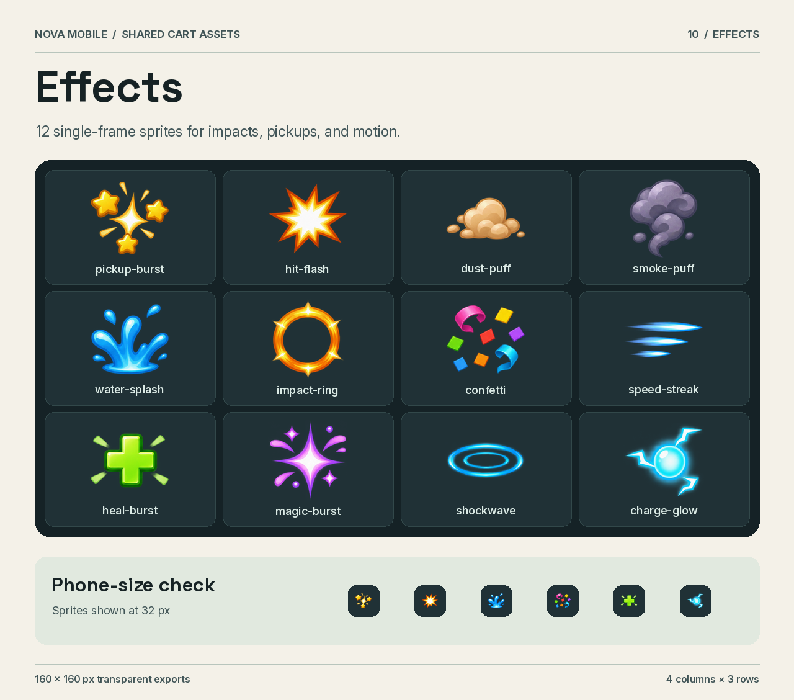

# Effects

Twelve illustrated single-frame effects for impacts, pickups, motion, and status feedback. Each individual PNG is 160 × 160 pixels with a transparent background. Copy the sprites you need from `sprites/` into your cart's assets and list them in `game.json`.

The transparent [sprite sheet](sheet.png) is 640 × 480 pixels with 160 × 160 cells. The cell names match the individual PNG filenames.

| Row | Column 1 | Column 2 | Column 3 | Column 4 |
|---|---|---|---|---|
| 1 | pickup-burst | hit-flash | dust-puff | smoke-puff |
| 2 | water-splash | impact-ring | confetti | speed-streak |
| 3 | heal-burst | magic-burst | shockwave | charge-glow |

Original generated artwork for NOVA Mobile.
