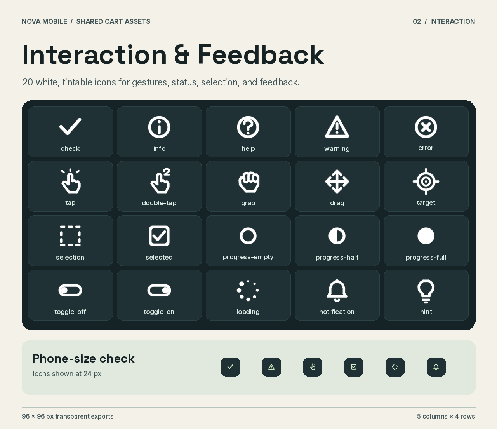

# Interaction & Feedback

Twenty white icons on transparent backgrounds, designed to be tinted by the cart. Each individual PNG is 96 × 96 pixels. Copy the icons you need from `icons/` into your cart's assets and list them in `game.json`.

The transparent [sprite sheet](sheet.png) is 480 × 384 pixels. Each cell is 96 × 96 pixels with no spacing between cells. The cell names below match the individual PNG filenames. Loading is a single frame that a cart can rotate.

| Row | Column 1 | Column 2 | Column 3 | Column 4 | Column 5 |
|---|---|---|---|---|---|
| 1 | check | info | help | warning | error |
| 2 | tap | double-tap | grab | drag | target |
| 3 | selection | selected | progress-empty | progress-half | progress-full |
| 4 | toggle-off | toggle-on | loading | notification | hint |

Original artwork for NOVA Mobile.
