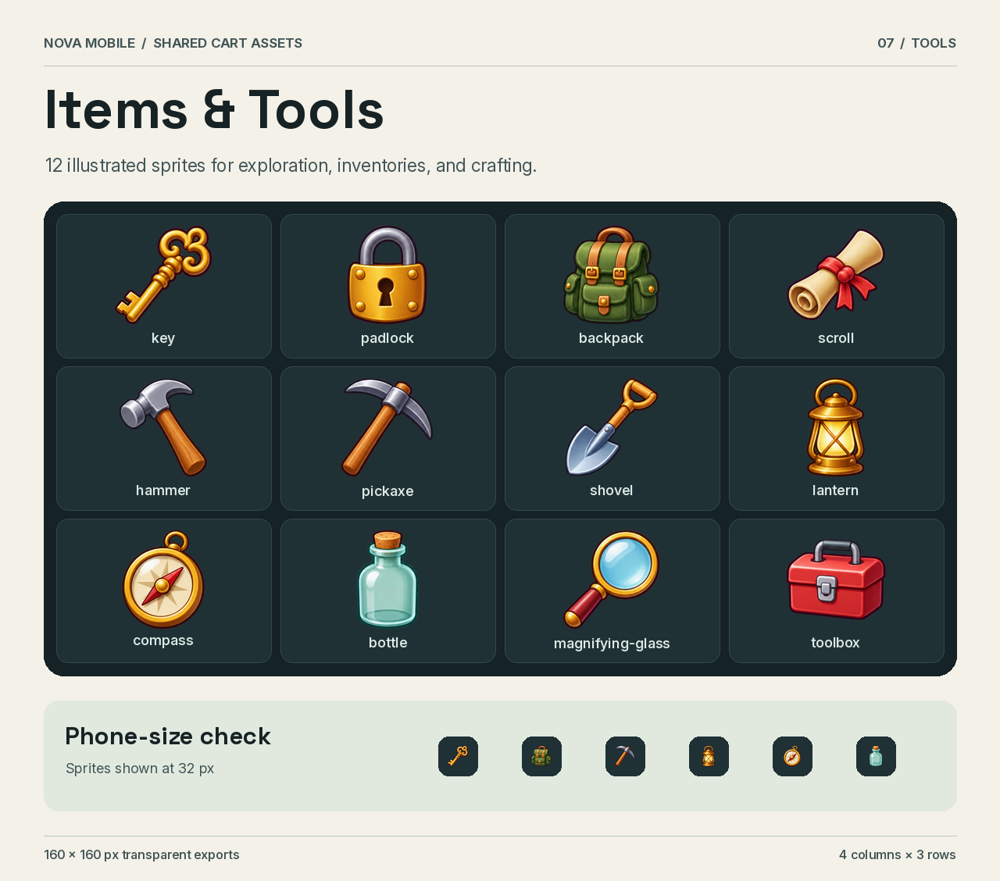

# Items & Tools

Twelve illustrated sprites for exploration, inventories, and crafting. Each individual PNG is 160 × 160 pixels with a transparent background. Copy the sprites you need from `sprites/` into your cart's assets and list them in `game.json`.

The transparent [sprite sheet](sheet.png) is 640 × 480 pixels with 160 × 160 cells. The cell names match the individual PNG filenames.

| Row | Column 1 | Column 2 | Column 3 | Column 4 |
|---|---|---|---|---|
| 1 | key | padlock | backpack | scroll |
| 2 | hammer | pickaxe | shovel | lantern |
| 3 | compass | bottle | magnifying-glass | toolbox |

Original generated artwork for NOVA Mobile.
