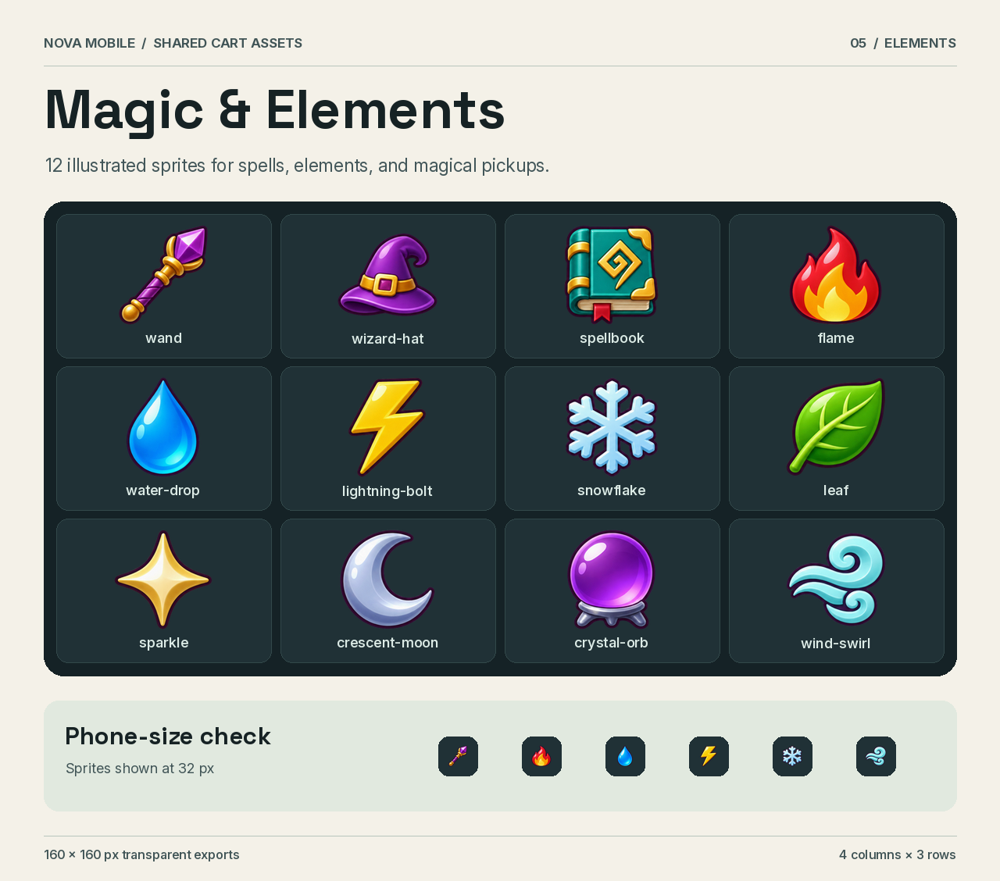

# Magic & Elements

Twelve illustrated assets for spells, elements, and magical pickups. Each individual PNG is 160 × 160 pixels with a transparent background. Copy the sprites you need from `sprites/` into your cart's assets and list them in `game.json`.

The transparent [sprite sheet](sheet.png) is 640 × 480 pixels with 160 × 160 cells. The cell names match the individual PNG filenames.

| Row | Column 1 | Column 2 | Column 3 | Column 4 |
|---|---|---|---|---|
| 1 | wand | wizard-hat | spellbook | flame |
| 2 | water-drop | lightning-bolt | snowflake | leaf |
| 3 | sparkle | crescent-moon | crystal-orb | wind-swirl |

Original generated artwork for NOVA Mobile.
