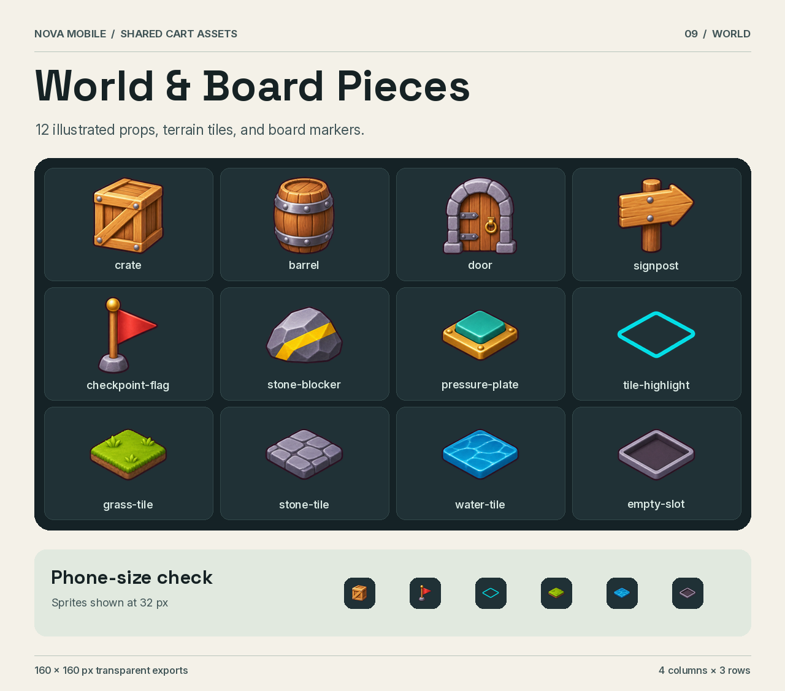

# World & Board Pieces

Twelve illustrated assets for world props, terrain, and board markers. Each individual PNG is 160 × 160 pixels with a transparent background. Copy the sprites you need from `sprites/` into your cart's assets and list them in `game.json`.

The transparent [sprite sheet](sheet.png) is 640 × 480 pixels with 160 × 160 cells. The cell names match the individual PNG filenames.

| Row | Column 1 | Column 2 | Column 3 | Column 4 |
|---|---|---|---|---|
| 1 | crate | barrel | door | signpost |
| 2 | checkpoint-flag | stone-blocker | pressure-plate | tile-highlight |
| 3 | grass-tile | stone-tile | water-tile | empty-slot |

Original generated artwork for NOVA Mobile.
